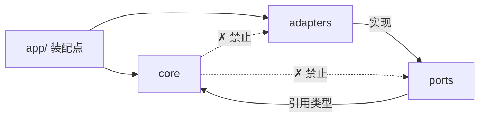
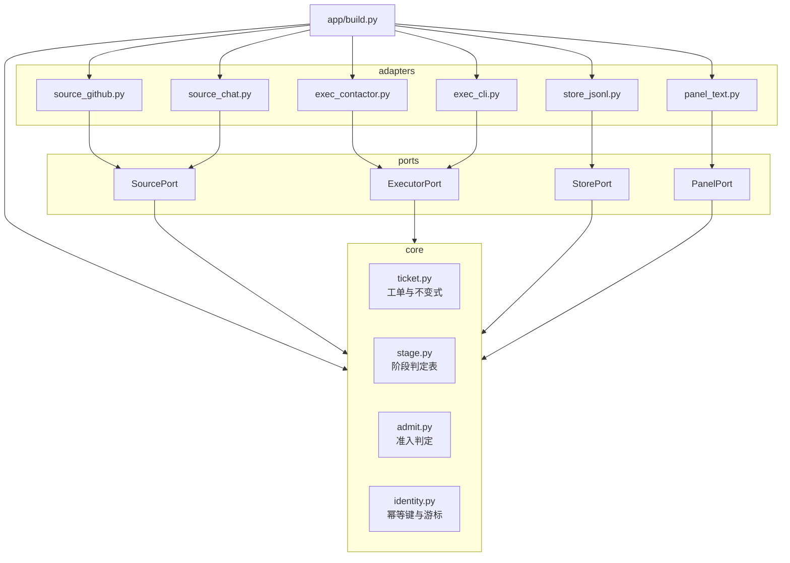

# xys-superagent-prototype —— 跨 agent 框架的轻量工单编排层

> 架构文档 v1 · 2026-11-01
> 状态：**设计规格，代码未落地**。文中所有 `file:line` 均为**计划位置**，
> 凡未实现处一律标【未实现】。依据的参考实现见 §13 出处表。

---

## 0. 先说人话

现在这台机器上，一个活是这样派出去的：我在对话里判断「谁空着」，用 `contactor` 把一段
prompt 发给 `dsh` 或 `dsh2`，然后自己记着它跑到哪了、要不要重启、重启之后哪条活作废了。
**记忆在对话里，判断在我脑子里，账本没有。**

活一多就出三种事故，每一种都发生过：

```
① 重复派活     桥重启后重派，两条 dsh 抢同一个仓库
② 误判卡死     排队被当成卡死、编译中被当成卡死、mtime 被当成空闲
③ 越权改范围   派它改 A，它顺手把 B 改了（source_id 那次）
```

`xys-superagent-prototype` 就是把这三种事故从「靠人盯着」改成「靠结构挡住」：

```
contactor     负责把话送到某个 agent 手上（手和脚）
xys-superagent   负责记住谁该干什么、干到哪一步、下一步等谁（工单和账本）
```

它不管 agent 内部怎么想，也不管 agent 用的是哪个框架——**换框架只换一个适配器**。

---

## 1. 目标与非目标

### 1.1 目标

| # | 目标 | 怎么算达成 |
|---|---|---|
| G1 | 派活不再靠对话记忆 | 每件活有一个工单，带状态、范围、账本 |
| G2 | 任意 agent 框架可接入 | 新增框架 = 新增一个适配器，`core/` 与 `ports/` 的 import 行逐字节不变 |
| G3 | 重启不重放、不重派 | 同一事件投两次 = 一张工单；进程重启后已消费事件不再产生工单 |
| G4 | 只打扰必要的人 | 面板只列「等人」的工单；健康状态不占一行 |
| G5 | 越权在结构上被挡住 | 越界请求只能「交回」，不能自己扩大范围 |
| G6 | 轻 | 单进程、零外部服务、无数据库也能跑；一次巡检 p95 < 2s（200 工单） |

### 1.2 明确不做

```
✗ 不做 agent loop      —— 不实现 LLM 调用、不实现工具面，那是 harness 的事
✗ 不做多租户权限系统   —— 只服务一个团队、一台机器
✗ 不做调度算法         —— 按工作区串行即可，不做最优分配
✗ 不替代 contactor     —— contactor 仍是执行底座，xys-superagent 只是它的上游
✗ 不做 Web 框架        —— 面板是静态文本/极简 HTML，不做前端工程
✗ 不做分布式           —— 单机单进程；要多机再说
```

**判据**：一条需求如果要求上面任一项，它不属于本系统，退回需求方。

---

## 2. 质量属性（非功能）

正文里散落的阈值一律收在这里，别处只引用不重写。

| 属性 | 要求 | 判据（可测） |
|---|---|---|
| 可替换性 | 换执行器/换事件源/换存储不动核心 | `core/` 与 `ports/` 的 import 行逐字节不变（SHA 比对） |
| 幂等 | 同一事件重复投递不产生第二张工单 | 同 key 投 2 次 → 工单数 +1 |
| 可恢复 | 进程重启不重放已消费事件 | 重启后新工单数为 0 |
| 延迟 | 一次巡检 p95 < 2s | 200 张工单夹具下计时 |
| 静默 | 无人在等时面板不输出 | healthy 工单增减，面板字节数不变 |
| 可观测 | 每次拒收/交回都留下理由 | 每条拒收记录含 `reason` 与 `where` |
| 安全 | 消息不能改变权限 | 改 config 的尝试只从配置文件生效，不从事消息生效 |
| 成本上限 | 单工单执行轮次有硬上限 | 超限即停并标记 `blocked`，不无限重试 |

---

## 3. 领域模型：借什么，丢什么

参考实现是 DeepSeek 的 `dsh-superagent-prototype`（GitHub `deepseek-ai/dsh-superagent-prototype`，
查于 2026-11-01，3498 stars，官方自述「research prototype for reference only」）[已证实]。

### 3.1 借的（概念，不是代码）

| 概念 | 它的定义 | 我们为什么借 |
|---|---|---|
| **Source** | 事件流，自己记读位置，重启不重放 | 我们正缺这个，桥重启就丢账 |
| **Trigger** | 一条不可变事件，接受两次只产生一张工单 | 直接解决「重复派活」 |
| **Thread** | 同一主题的事件序列，同一时刻只跑一次判定 | 解决「同一件事被并行处理两次」 |
| **Ticket** | 工单，带 **Mandate**（允许干到哪） | 直接解决「越权改范围」 |
| **Executor** | 一张工单一个 session，一个目录 | 我们现在是手工分配 + ad hoc worktree |
| **Stage** | 首次命中即定的阶段表 | 直接替换我们误判三次的 if-else |
| **Panel** | 只显示等人的事，健康不占位 | 直接改我们的全量看板 |

### 3.2 丢的（不抄的部分）

```
✗ 它的 TS 实现        —— 我们只需要一个单进程脚本，重写成框架是净亏
✗ 它的 Source 插件体系 —— 我们只有三四个源，一个函数一个源就够
✗ 它的 Eval/Assessor  —— 它用模型判断「这条消息是不是在要活」，我们先用允许名单 + 明确 @
✗ 它的 Feishu 集成    —— 需要时再加适配器
```

**★ 判据（来自 `architecture-design` §十）**：借的是**依赖方向与关注点隔离**，不是**目录树**。
拆包的理由必须是「它跟别人因为不同的原因而变」，不是「这样更像它」。

### 3.3 我们的领域概念（只多两个）

```
WorkRef    一件活指向的东西：仓库路径 + 分支 + 范围（不是 prompt）
Decision   一次准入判定的结果：Admit / Reject(reason) / Candidate（机器人只能到此）
```

其余全部用它的原词，不另造词。

---

## 4. 从变化频率推导分层

### 第 1 步：列变化频率

从「变得最快」到「最稳定」：

```
变得最快 ───────────────────────────────────────────────► 最稳定

面板长什么样      agent 框架（dsh / claude / cursor / CLI）
消息渠道（QQ / 飞书 / GitHub）     存储实现（JSONL / SQLite）
        ↓                                    ↓
                 团队政策（允许谁、什么算明确请求）
                                ↓
                    工单的生命周期与阶段语义
                                                          ↓
                                           「活」与「授权」本身
```

判断依据用的是「这条规则是团队特有还是行业通用」+「改它要不要动别的东西」：

- **工单是什么、什么叫干完、什么算越界** —— 行业通用的协作概念，十年不变 → 最稳
- **阶段表的具体行** —— 会随团队习惯微调，但改的是表不是代码 → 中稳
- **允许名单、什么算明确请求** —— 团队特有，换团队就变 → 中易变
- **面板、渠道、框架、存储** —— 技术选型，随时换 → 最易变

### 第 2 步：按频率切层

| 层 | 装什么 | 变化频率 | 依赖 |
|---|---|---|---|
| `core/` | 工单、阶段判定、准入判定、幂等键、账本语义 | 最稳 | **零外部依赖** |
| `ports/` | 四个端口的接口定义 | 稳（跟着 core 走） | 只依赖 `core/` 的类型 |
| `adapters/` | GitHub/QQ 源、contactor/CLI 执行器、JSONL 存储、文本面板 | 最易变 | 依赖 `ports/` |
| `app/` | 装配点：读配置、选适配器、起循环 | 易变（但只有一处） | 依赖全部 |

### 第 3 步：画箭头，全部指向稳定侧



规则：

```
core/   不许 import 任何东西（标准库除外）
ports/  只许 import core/
adapters/ 只许 import ports/ 与 core/ 的类型，不许互相 import
app/    唯一可以 import adapters/ 的地方
```

### 第 4 步：唯一装配点

```
app/build.py :: build_app(config) -> App
```

全项目只有这一处 `new` 具体实现。测试时换掉它 = 换掉整个运行环境。

---

## 5. 依赖图（模块级）



**没有环**：`core` 不指向任何人；`ports` 只指向 `core`；`adapters` 只指向 `ports`；`app` 指向全部。

★ 这条不能只写在文档里——`scripts/check_layering.py` 扫一遍 import，环与反向依赖必须让它变红（见 §12）。

---

## 6. 端口清单（强弱分级）

判据来自 `architecture-design` §二：**把接口拿给一个不懂这个技术栈的人看，他能看懂吗？**

### 6.1 SourcePort（事件从哪来）

```python
# ports/source.py
class SourcePort(Protocol):
    def next_batch(self, cursor: Cursor) -> tuple[list[Trigger], Cursor]: ...
    def acknowledge(self, cursor: Cursor) -> None: ...
```

| 档 | 写法 | 问题 |
|---|---|---|
| ✗ 弱 | `poll_github(since: datetime) -> list[dict]` | 「github」「poll」都是技术词，内部知道外面有 GitHub |
| ✓ 强 | `next_batch(cursor) -> (events, cursor)` | 只知道「有一串事件和游标」 |

### 6.2 ExecutorPort（活交给谁干）

```python
# ports/executor.py
class ExecutorPort(Protocol):
    def hand_off(self, mandate: Mandate, work: WorkRef) -> Assignment: ...
    def deliver(self, assignment: Assignment, message: Message) -> Delivery: ...
    def stop(self, assignment: Assignment, reason: str) -> None: ...
```

| 档 | 写法 | 问题 |
|---|---|---|
| ✗ 弱 | `send(agent: str, text: str, context_id: str) -> task_id` | 全是 contactor 的词汇，内部知道「外面有个 agent 叫 dsh」 |
| ✓ 强 | `hand_off(mandate, work) -> Assignment` | 只知道「有个东西接活，并给回一个句柄」 |

**`Assignment` 是不透明句柄**（一个字符串），核心不解释它，只有适配器知道它是 taskId 还是 pid。

### 6.3 StorePort（账本）

```python
class StorePort(Protocol):
    def append(self, record: Record) -> Cursor: ...
    def since(self, cursor: Cursor | None) -> list[Record]: ...
    def find(self, key: str) -> Record | None: ...
```

| 档 | 写法 | 问题 |
|---|---|---|
| ✗ 弱 | `save_to_sqlite(t) / read_jsonl()` | 存储技术漏进端口 |
| ✓ 强 | `append(record) -> Cursor` | 只知道「追加、按游标读」 |

### 6.4 PanelPort（给人看的那一面）

```python
class PanelPort(Protocol):
    def publish(self, view: AttentionView) -> None: ...
```

| 档 | 写法 | 问题 |
|---|---|---|
| ✗ 弱 | `render_html(cards: list[dict])` | 表现技术漏进端口 |
| ✓ 强 | `publish(view)` | 只知道「有一份要人看的视图」 |

### 6.5 端口统计

```
共 4 个端口：强 4 / 弱 0
★ 一个真实项目里 13 个端口 9 强 4 弱是正常分布；全标强要怀疑自己没认真看。
  这里只有 4 个且都很窄，是因为系统本身就小 —— 如果实现时冒出第 5 个端口，
  先问它是不是某个适配器的私事。
```

---

## 7. 运行视图：一件活的一生

### 7.1 主循环

```
每 2 秒一次 pass（单线程，上一轮没完不开下一轮）
  ① 从每个 SourcePort 取 next_batch(cursor)
  ② 对每条 Trigger：算幂等键 → 已存在则丢弃 → 否则写 Trigger 记录
  ③ 对未决 Trigger 跑 admit() → Admit / Reject / Candidate
  ④ Admit ⇒ 建 Ticket（带 Mandate），落账
  ⑤ 扫所有 open 工单，算 stage；stage 属 working/queued 且有空槽 ⇒ hand_off
  ⑥ 收执行器回报（deliver/report 走同一端口）→ 落账
  ⑦ 重算 stage → publish(view)
  ⑧ 持久化游标（**在 ⑥ 之前落盘**，见 §9）
```

### 7.2 阶段判定表（**从上往下第一条命中**）

| 阶段 | 判定条件 | 面板标签 | 等人？ |
|---|---|---|---|
| `undelivered` | 向执行器投递失败，重试中（2s → 翻倍到 60s） | 输入未送达 | 是 |
| `waiting_answer` | 有一条未回答的提问 | 待回答 | 是 |
| `waiting_review` | 最新报告为 `ready` | 待审阅 | 是 |
| `blocked` | 最新报告为 `blocked` / `failed`，且此后没人说话 | 受阻·失败 | 是 |
| `queued` | 没有 assignment，或有待处理 assignment | 排队中 | 否 |
| `idle` | 最新报告为 `waiting`，或 assignment 已结束 | 等触发 | 否 |
| `working` | 其余（**含「回合结束了但后台任务还在跑」**） | 工作中 | 否 |

**★ 最后一行是替换我们误判的关键**：参考实现规定「turn 结束时还有 shell 任务或 subagent 在跑，
工单保留槽位、仍算 working」。我们编译 40 分钟被判卡死，根因就是没有这一行。

**★ 这张表是纯函数**：`stage_of(snapshot) -> Stage`，12 个快照夹具跑表驱动测试。

### 7.3 幂等与游标

```
trigger_key = f"{source_id}:{external_id}"
  同一 key 第二次进入 ⇒ 返回已存在的工单，不新建、不重派

cursor  = 每个 source 一个，持久化在账本里
  规则：先落 cursor，再投递执行器
  ⇒ 最坏情况是「事件被消费但没派出去」（可重放），
    不是「派出去了但账本不知道」（重复派活，我们现在这种）
```

**取舍**（写给下一个改代码的人）：这里选的是 **at-least-once + 幂等**，不是 exactly-once。
因为 exactly-once 需要两阶段提交，而我们连数据库都没有。代价是可能漏派一次，需要人工补；
收益是永远不会重复派——重复派抢同一个仓库的代价比漏派大得多。

---

## 8. 授权：结构挡，不靠散文

参考实现的原话（`docs/002-authorization.md`，查于 2026-11-01）[已证实]：

> Messages, comments and quoted documents are inputs to a decision; they cannot change those permissions.

我们照这条做，落成三个纯函数：

```python
# core/admit.py
def admit(trigger: Trigger, policy: Policy) -> Decision:
    """只有三种结果，没有第四种。"""
    # Admit     —— 允许名单里的人，直接 @ 了 agent
    # Candidate —— 机器人在名单里，只能产生候选，永不产生明确请求
    # Reject    —— 其余一切，带 reason
```

| 规则 | 判据 | 反例（必须被挡） |
|---|---|---|
| 只有允许名单的人能起活 | `trigger.actor in policy.allowed_people` | 群里路人 @ 一句「顺便把 X 也改了」 |
| 机器人只能产候选 | `trigger.actor_kind == bot ⇒ Candidate` | CI 机器人说「请合并」 |
| 订阅线程的消息不改权限 | 只是上下文，不触发 admit | 有人在工单线程里说「你顺手把仓库 A 也改了吧」 |
| 越界只能交回 | 执行器回报 `out_of_scope` ⇒ 交回一次，不新建工单 | 执行器自己去改另一个仓库 |

### 8.1 Mandate（工单的授权范围）

```python
@dataclass(frozen=True)
class Mandate:
    scope_paths: tuple[str, ...]      # 只许改这些路径
    allowed_actions: frozenset[str]   # 提交 / 提测 / 只读
    max_rounds: int                   # 执行轮次硬上限
    stop_conditions: tuple[str, ...]  # 命中即停，交回
```

**它解决的是 source_id 那次事故**：派它改题四的检索，它顺手改了身份编码。
有了 `scope_paths`，那次改动在结构上就出不去——不是「你不该这么干」，是「这不在你的工单里」。

### 8.2 拒收理由必须回流

`architecture-design` §十一③：拒了要说清「给谁」和「说清什么」一样重要。

```
Reject(reason) ⇒ 写进账本（可观测）
              ⇒ 同时回到发起的那条会话（可修正）
```

只写账本不回到人，下一轮还会犯同样的错。

---

## 9. 面板：只显示等人的

```python
# core/panel.py
def attention_view(tickets: list[TicketView]) -> AttentionView:
    """只保留 stage ∈ {undelivered, waiting_answer, waiting_review, blocked}"""
```

| 规则 | 判据 |
|---|---|
| 健康不占位 | 新增一张 `working` 工单，面板输出字节数不变 |
| 等人优先 | 列表按「等最久」排，不按创建时间 |
| 一条一行 | 每行：工单短名 / 阶段 / 一句话说明等谁 / 指向工单的命令 |

参考实现的原话（`docs/000-philosophy.md`）[已证实]：

> A panel that shows only what needs a person. It lists first what waits for a person.
> **A healthy state takes no space.**

---

## 10. 并发与槽位

```
槽位（slot）= 一个可以干活的位置，按工作区划分
  规则一：同一工作区同时只允许一张工单处于 working
  规则二：工单回合结束后若仍有后台任务在跑，仍占槽位、仍算 working
  规则三：槽位满 ⇒ 新工单进 queued，不驱逐正在跑的
```

**为什么按工作区而不是按 agent**：两个 agent 改同一个仓库会抢文件（我们在 `seekdb` 上撞过）。
按 agent 分槽挡不住这件事，按工作区分才挡得住。

### 10.1 长任务：参考实现的 30 分钟上限，我们必须跨过去

参考实现写死了一条（`docs/003-execution.md`，查于 2026-11-01）[已证实]：

> After each turn, background work has at most 30 minutes to finish.
> **At that limit, shell jobs are killed** and the Ticket is reported waiting.

它这么设计是因为它的活是 PR 级（改几行、跑个测试）。**我们的活不是**：

```
OceanBase 全量编译      40 分钟以上
benchmark 5+5 轮交错    1 小时以上
模型评测批量            数小时
```

⇒ 30 分钟上限在我们的场景里**每个长活都会被误杀一次**，而误杀之后工单会被判成 waiting，
人看到的是「干完了」，实际是「被打断了」。

**我们的策略（三件，缺一件长活就掉）**：

| 机制 | 做法 | 判据 |
|---|---|---|
| **分段推进** | 把长活切成「可停下」的段，每段一个 commit / 一个产物 | 任一段结束后杀掉进程，重跑能接着推进 |
| **心跳** | 执行器每隔 N 分钟写一次进度（阶段 + 已完成的段） | 30 分钟无心跳 ⇒ 才判 stalled |
| **跨会话续跑** | 续跑用同一 `contextId` + 段清单，不复述历史 | 续跑后不重做已完成的段 |

**判据写死**：`stalled` 的定义不是「30 分钟没动静」，是「**心跳断了**」。
这条直接修掉我们现在的问题——编译 40 分钟被 collector 判成卡死（因为它在看 mtime，
不是看心跳）。

---

## 11. 迁移：和现有系统的关系

```
现在                                   之后
─────────────────────────────────────────────────────────
对话里判断派给谁          →   xys-superagent 按 stage + 槽位自动 hand_off
ob-pipeline/collector.py 的 if-else 猜卡死  →   stage_of() 查表
dashboard_ob.json 全量摊开  →   attention_view() 只列等人的
桥重启后任务作废          →   cursor + trigger_key 保证不重放、不重派
AGENTS.md 散文约束范围     →   Mandate.scope_paths 结构约束
```

**保留不动**：`contactor`（执行底座）、`ob_guard`（文件系统哨兵，仍是最后一道闸）、
各 agent 自己的 harness 与 prompt。

**迁移顺序**（先能跑，再替换，不要一次推倒）：

```
① 只读模式：xys-superagent 只读 contactor 的 tasks 列表 + 账本，产出 attention_view
   不派活、不改任何东西 —— 先证明阶段表判得对
② 接管派活：把现有手工派活改成 hand_off，仍由人点头
③ 接管范围：给每张工单加 mandate，越界走交回
④ 撤掉 collector 的判断逻辑
```

---

## 12. 验收判据（可进 CI）

★ 每条都配一个**反例（必须变红）**——只跑正例测不出判据质量。

| # | 判据 | 正例 | 反例（必须失败） |
|---|---|---|---|
| C1 | 换执行器不动核心 | `exec_cli` 换掉 `exec_contactor`，`core/`+`ports/` import 快照 SHA 不变 | 在 `core/` 里 `import adapters` ⇒ 检查红 |
| C2 | 幂等 | 同 `trigger_key` 投 2 次 → 工单数 +1 | 把 key 改成随机 UUID ⇒ 检查红 |
| C3 | 重启不重放 | 消费后重启 → 新工单 0 | 删掉 cursor 持久化 ⇒ 检查红 |
| C4 | 阶段表 | 12 个快照夹具逐条对上 | 把「有后台任务」判成 `idle` ⇒ 检查红 |
| C5 | 面板静默 | 加一张 `working` 工单，输出字节不变 | 把 `working` 也渲染 ⇒ 检查红 |
| C6 | 越界交回 | 执行器回报 `out_of_scope` → 工单不变、无新工单 | 允许越界自建工单 ⇒ 检查红 |
| C7 | 拒收回流 | 每次 Reject 有 `reason` 且回到源会话 | 只写账本不回源 ⇒ 检查红 |
| C8 | 分层无环 | `check_layering.py` 报告「扫过、无环」 | 加一条 `adapters` 互 import ⇒ 检查红 |

C8 必须是**脚本**，不是人眼：`scripts/check_layering.py` 扫 import 图，输出环与反向依赖清单。

---

## 13. 机制三问（哪一行 / 谁调用 / 哪条测试红）

★ 按 `architecture-doc-writing` 的硬要求：**答不上来的等于没做，不许写成已完成。**
本文件是设计规格，下表因此**全部标【未实现】**，给出的是计划位置。

| 机制 | 计划位置 | 谁调用 | 违反时哪条测试红 | 状态 |
|---|---|---|---|---|
| 阶段判定 | `core/stage.py::stage_of` | `app/loop.py` 每次 pass | `test_stage_table`（C4） | 【未实现】 |
| 幂等键 | `core/identity.py::trigger_key` | `core/store` 落账前 | `test_idempotent_trigger`（C2） | 【未实现】 |
| 游标先行 | `app/loop.py` 第 ⑧ 步 | 主循环 | `test_cursor_before_dispatch`（C3） | 【未实现】 |
| 准入判定 | `core/admit.py::admit` | `app/loop.py` 第 ③ 步 | `test_admit_matrix`（C7） | 【未实现】 |
| 范围约束 | `core/ticket.py::Ticket.accepts` | `ExecutorPort.deliver` 前 | `test_out_of_scope_handback`（C6） | 【未实现】 |
| 面板过滤 | `core/panel.py::attention_view` | `app/loop.py` 第 ⑦ 步 | `test_panel_silent`（C5） | 【未实现】 |
| 槽位互斥 | `core/slot.py::acquire` | `hand_off` 前 | `test_one_worker_per_workspace` | 【未实现】 |
| 分层约束 | `scripts/check_layering.py` | CI / 提交前 | 自身即判据（C8） | 【未实现】 |

**交付前必须把这列全变成实际行号**——现在它们只是计划，谁照着这份文档开工，
第一件事是把「计划位置」改成「`file:line`」，并把状态从【未实现】改成【已实现·测试名】。

---

## 14. 待拍点（需要人决定的三个）

下面三条我给了**默认**，文档其余部分按默认写。要反哪条，说一声即可。

### D1：谁能起活

| 选项 | 含义 | 代价 |
|---|---|---|
| **A（默认）** | 只有允许名单里的人**明确 @** 才起活；定时巡检只**记录**不派 | 人手点一下；但不会误起活 |
| B | 允许规则驱动的自动起活（CI 失败 / 定时任务自动开工） | 省人；但「没让它干它却干了」的风险回到系统里 |

倾向 A：参考实现的哲学原话是「它只在被要求时行动，或在团队写下的规则允许时行动」，
而规则驱动的第一版应该先跑**记录模式**（只记它会做什么，不真做）——这条它也是这么写的。

### D2：执行器会话粒度

| 选项 | 含义 | 代价 |
|---|---|---|
| **A（默认）** | 一张工单一个 session、一个目录 | 隔离好、可追溯；启动成本高 |
| B | 同一工作区复用长 session | 省 token 与启动；上下文会串味，工单之间互相污染 |

倾向 A：我们的历史事故（题三被 cancel 后现场丢失）正是因为没有「工单 = 会话 = 目录」这个绑定。

### D3：账本存哪

| 选项 | 含义 | 代价 |
|---|---|---|
| A | 追加式 JSONL + 内存索引，定期快照 | 零外部依赖、可 git、人眼可读；但幂等要靠代码保证，游标与投递无法原子 |
| **B（默认，已改）** | SQLite 单文件 | 唯一索引 = 幂等免费拿到；事务 = 「落游标」与「建工单」原子；`sqlite3` 是 Python 标准库，**同样是零外部依赖** |

**默认改成了 B，理由有三条**：

```
① 幂等不用自己写：CREATE UNIQUE INDEX ON triggers(source_id, external_id)
   —— 重复投递由数据库拒绝，不是靠 if 判断
② 游标与工单可以同一个事务落盘 ⇒ §7.3 那个「先落游标再投递」的取舍从纪律变成事务
③ sqlite3 在标准库里，选项 A 的「零依赖」优势不存在
```

参考实现选的也是 SQLite（`src/app/store.ts`「owns one SQLite database」，
Runtime 先拿目录锁再开库，查于 2026-11-01）[已证实]——**它踩过的坑我们没必要再踩一遍**。

★ 剩下的唯一限制是「单写者」：SQLite 支持多读者单写者，我们仍是单进程 + 目录锁。
这条要写死在这里，免得以后有人悄悄开第二个进程写同一个账本。

### D1：谁能起活

| 选项 | 含义 | 代价 |
|---|---|---|
| **A（默认）** | 做 `exec_cli`（直连命令行 agent）作为第二实现 | 多写一个适配器；但**这是证明 G2 的唯一办法** |
| B | 只做 `exec_contactor` | 省事；但「任意框架可接入」这句话没有任何证据 |

倾向 A：只做一个适配器时，端口会成为「事后给唯一实现套的壳」，第一个换实现的人就会发现它漏了东西。

---

## 15. 出处与置信度

| 论断 | 出处 | 查于 | 置信度 |
|---|---|---|---|
| 领域模型（Source/Trigger/Thread/Ticket/Mandate/Executor） | `deepseek-ai/dsh-superagent-prototype` `docs/001-domain.md` | 2026-11-01 | [已证实] |
| 阶段表「首次命中」与七种阶段 | 同上 `docs/003-execution.md` | 2026-11-01 | [已证实] |
| 消息不能改变权限 | 同上 `docs/002-authorization.md` | 2026-11-01 | [已证实] |
| 面板只显示等人的 | 同上 `docs/000-philosophy.md` | 2026-11-01 | [已证实] |
| 「回合结束仍有后台任务则保留槽位」 | 同上 `docs/003-execution.md` | 2026-11-01 | [已证实] |
| 前台命令 5 秒转后台 | 同上 `docs/003-execution.md` | 2026-11-01 | [已证实] |
| 该项目自称研究原型、非正式产品 | 同上 `README.md` | 2026-11-01 | [已证实] |
| 分层/端口/装配点方法论 | 本地 skill `architecture-design` | — | [已证实] |
| 「新增框架不动核心」的可行性 | 本文设计推演 | — | [推测]（未实现，无实测） |
| 单机 JSONL 够用（每天几十张工单） | 基于当前用量估算 | — | [待验]（有量之后要复核） |

---

## 16. 与参考实现的能力边界

这一节回答一个问题：**哪些地方我们该超过它，哪些地方认输，差距是什么性质。**
凡引用它的行为，均出自其 `docs/` 与 `README`（查于 2026-11-01）[已证实]。

### 16.1 该超过的三处（不是「努力超过」，是结构上我们站得更前）

| # | 它做不到 | 为什么做不到 | 我们凭什么 |
|---|---|---|---|
| S1 | **跨 agent 框架** | 它自身是 DSH 的 bundle，还定义了专用 preset（`dsh-superagent-worker` / `-router`），并改进程级 `PATH` 与 git 配置 | `ExecutorPort` 只有一个 `hand_off(mandate, work) -> Assignment`，`Assignment` 是不透明句柄；contactor 已经把 ACP / CLI 两类 agent 抹平过一遍 |
| S2 | **一个实例管多个仓库** | README 写明「for one GitHub repository」，每个实例一个 Source 绑一个 repo | 槽位按**工作区**而不是按实例；多仓是我们的常态（seekdb / powercontext / 桌面项目同时跑） |
| S3 | **小时级长活** | 后台任务 30 分钟硬杀，杀完报 waiting | §10.1 的分段推进 + 心跳 + 跨会话续跑；`stalled` 定义成「心跳断」而不是「没动静」 |

**这三条都不是「它做得不好」，是它的场景不同**：它服务一个团队一个仓库、活是 PR 级。
我们的场景是「一台机器上多个赛道并行、单个编译 40 分钟」。**照抄它的参数会直接把我们的活杀光。**

### 16.2 该认输的四处（不抄，也不假装能做得更好）

| # | 它强在哪 | 我们为什么不追 |
|---|---|---|
| W1 | **产品完整度**：Web 面板、Setup 向导、按阶段编号的文档、可跑的安装流程 | 我们不做前端工程；面板是极简文本。追这个要花掉全部预算，换来的只是好看 |
| W2 | **成熟度**：3498 star 的可跑原型，踩过的坑写在文档里 | 我们是设计规格、零行代码。这一条短期内追不上，**所以每条机制都必须挂 CI 判据**，用判据补成熟度 |
| W3 | **模型判定起活**（`MasterAssessor` 判断「这条消息是不是在要活」） | 我们不抄：误起活的代价（派错活、抢仓库）在我们这里比漏起活高得多。用允许名单 + 明确 @（D1 默认 A） |
| W4 | **Source 插件体系**（可扩展的事件源） | 我们只有三四个源，一个函数一个源够用；插件体系是无用处区（`architecture-design` §四） |

### 16.3 平手的两处

| 项 | 说明 |
|---|---|
| 账本 | 它用 SQLite + 目录锁；我们把 D3 默认从 JSONL 改成 SQLite，同样是单进程单写者 |
| 权限模型 | 都是「消息不能改权限」+ Mandate 限范围。概念一致，实现各异 |

### 16.4 边界差距一览

```
维度            它                            我们                    谁强 / 性质
──────────────────────────────────────────────────────────────────────────────
执行框架        仅 DSH（bundle 绑死）          任意（端口 + contactor） 我们强 ★真差异
仓库范围        一实例一仓                     多工作区一实例           我们强 ★真差异
长任务          30 分钟硬杀                    分段+心跳+续跑           我们设计强 / 它实现强
并发控制        全局槽 + 1 个人工槽            按工作区互斥槽           我们更贴场景
账本            SQLite + 目录锁                SQLite（本文 D3）        平
起活判定        模型 Eval                      名单 + 明确 @            取舍不同（它灵活，我们保守）
事件源          GitHub 通知 + 可选飞书         GitHub / 聊天 / 定时     它更成熟，我们够用
面板            Web 面板 + 向导                极简文本                 它强（我们不做）
判据            pnpm check                     C1–C8 + 反例             我们目标强（未实现）
成熟度          可跑原型                       零行代码                 它强
```

### 16.5 一句话

**我们在「换框架」和「多仓库」上结构性地赢，在「成熟度、面板、事件源生态」上认输；
唯一必须自己补的是长任务——因为它那条 30 分钟上限会直接杀掉我们的编译。**

---

## 17. 一句话总结

**contactor 是手脚，xys-superagent 是工单和账本。**
工单带范围，阶段查表不猜，事件幂等不重放，面板只喊该来的人。
换 agent 框架只换一个适配器，核心一行不动。
